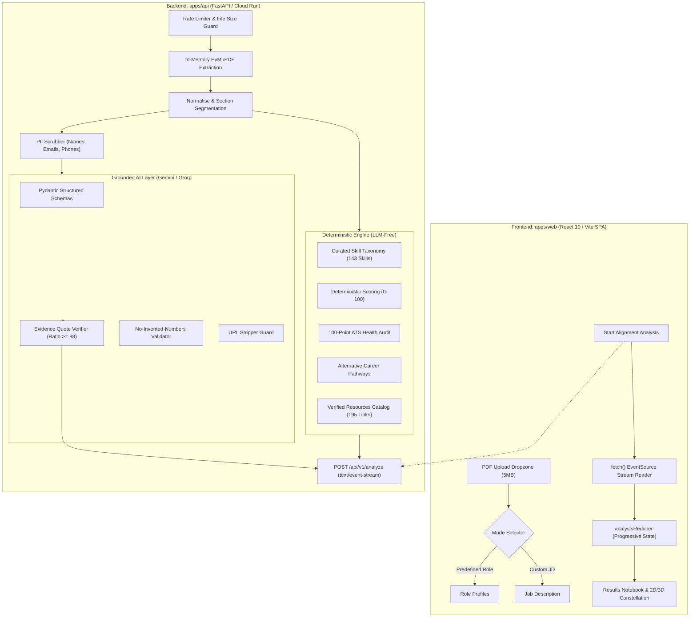

# Smart Resume Screener

> A public, no-login web application that analyses a PDF resume against a target job and returns an explainable match score, verified skill gaps, 100-point ATS health audit, improvement suggestions, alternative roles, and a phased learning roadmap with verified educational resources.

[-brightgreen)]()
[]()
[-brightgreen)]()
[]()
[]()

---

## 1. Product Truth & Hard Principles

- **Deterministic Scoring:** The match score (0–100) and ATS health audit are calculated strictly by deterministic mathematical algorithms. The LLM never sets or influences the score.
- **Evidence-Backed Claims:** Every claim displayed in the UI carries an exact verbatim evidence quote verified to exist in the candidate's extracted resume text (`partial_ratio >= 88`).
- **Zero Invented Achievements:** Improvement suggestions never invent metrics, figures, or achievements. Quantitative spaces appear strictly as bracketed placeholders (e.g. `[X%]`) that candidates must fill.
- **Verified Resource Links:** 100% of educational course and documentation links originate from an in-memory verified catalog of 195 official resources; the LLM is prohibited from emitting URLs.
- **Privacy by Construction:** Zero databases, zero disk writes, zero resume or JD text in server logs. All PII (names, emails, phones, addresses) is scrubbed in volatile RAM before LLM inference.
- **Graceful Degradation:** If the LLM provider is down or unconfigured, the application returns full deterministic scores, skill matrices, health audits, and curated roadmaps without failing.

---

## 2. 5-Command Local Setup

### Prerequisites
- Python 3.12+ with [uv](https://github.com/astral-sh/uv)
- Node.js 20+ with [pnpm](https://pnpm.io/)

```bash
# 1. Clone the repository
git clone https://github.com/your-org/smart-resume-screener.git && cd smart-resume-screener

# 2. Setup backend environment and install dependencies
cd apps/api && uv sync && .venv/bin/python -m spacy download en_core_web_sm

# 3. Setup frontend dependencies
cd ../web && pnpm install

# 4. Start backend FastAPI server (http://127.0.0.1:8000)
cd ../api && uv run uvicorn app.main:app --port 8000 --reload

# 5. In a new terminal, start frontend dev server (http://127.0.0.1:5173)
cd apps/web && pnpm dev
```

---

## 3. Architecture & Separation of Concerns



---

## 4. Deterministic vs Grounded AI Matrix

| Section | Computing Engine | Implementation | Guarantee |
|---|---|---|---|
| **Overall Match Score** | Deterministic Engine | Monotonic cosine similarity + taxonomy overlap | $0$ LLM influence; mathematically reproducible |
| **Skills Matrix** | Deterministic Engine | RapidFuzz extraction + synonym normalization | Verified quote cross-check (`partial_ratio >= 88`) |
| **ATS Health Audit** | Deterministic Engine | Rule-based regex parser (100 pts) | Objective scores for action verbs, tense, sections |
| **Alternative Careers** | Deterministic Engine | Embeddings dot-product against 14 profiles | 100% deterministic ranking |
| **Learning Roadmap** | Curated Catalog + AI | 195 verified resources catalog | 0 dead links; 0 arbitrary LLM URLs |
| **Bullet Rewrites** | Grounded AI Layer | Gemini 2.5 Flash / Groq LLM | Numbers from source text or bracketed placeholders |
| **Interview Prep** | Grounded AI Layer | Structured Pydantic schema | Grounded exclusively in verified resume evidence |

---

## 5. Testing & Verification Commands

### Backend Verification
```bash
cd apps/api
# Run unit & integration tests with coverage (51 tests, 88% coverage)
uv run pytest --cov=app

# Run linter and typecheck
uv run ruff check .
uv run mypy .

# Verify 100% active status of all 195 curated educational links
uv run python -m scripts.verify_resources
```

### Frontend Verification
```bash
cd apps/web
# Run Vitest test suite (24 unit/integration tests)
pnpm test

# Run ESLint & strict TypeScript typecheck
pnpm lint
pnpm typecheck

# Run Playwright E2E and Axe accessibility audits (9 tests, WCAG 2.2 AA)
pnpm e2e
```

---

## 6. Production Deployment

Refer to [`docs/deploy.md`](docs/deploy.md) for full Cloud Run and Vercel production runbooks.

- **Google Cloud Run:** Pre-baked Docker container (`apps/api/Dockerfile`) with offline model weights and zero persistent storage.
- **Vercel:** Static SPA export with edge security headers (`apps/web/vercel.json`).

---

## 7. License

MIT License. Designed with privacy by construction.

