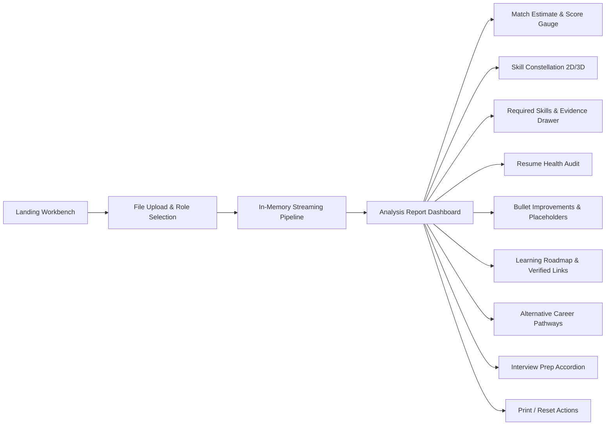

# Smart Resume Screener: Complete UI/UX Product Concept & Design System Specification

---

## 1. Overall Application Concept

### 1.1 Product Purpose & Identity
The **Smart Resume Screener** is an analytical SaaS application built for job candidates, engineers, and career professionals who want an objective, mathematically transparent evaluation of their resume against specific technical job benchmarks.

Unlike conventional Applicant Tracking Systems (ATS) that operate as opaque algorithmic black boxes, Smart Resume Screener is designed with the philosophy of **deterministic scoring, explainable AI, and strict privacy by construction**:
- **Candidate-Centric**: The reader is the candidate. It does not scrape job boards or act as a recruitment portal; it screens a single uploaded resume against a chosen target role or custom job requisition.
- **Mathematical Transparency**: Resume alignment scores, health audits, and skill gap analyses are computed deterministically through rigid weighting models. Artificial intelligence is employed solely for qualitative contextual synthesis, bullet rewrites, and interview preparation—never for fabricating arbitrary numerical scores.
- **Zero-Retention Guarantee**: Built on a zero-disk footprint architecture where resume files and parsed tokens reside exclusively in volatile memory during analysis and are immediately purged upon completion or session disconnect.

### 1.2 Target Audience
- **Software Engineers & Technical Candidates**: Professionals preparing resumes for specialized technical roles (Backend, Frontend, Full-Stack, Machine Learning, DevOps, Cloud Architecture, etc.) who require precise gap analysis between their experience and market expectations.
- **Career Changers & Transitioning Technologists**: Candidates assessing transferable competencies toward adjacent pathways and seeking actionable, curated learning roadmaps to close specific skill deficits.
- **Interview Seekers**: Job applicants wanting targeted, resume-grounded behavioral and technical interview preparation questions.

### 1.3 Visual Identity & Atmospheric Tone
The visual identity embraces a **"Console Workbench / Analytical Cockpit"** aesthetic:
- **Restrained Dark Aesthetic**: A deep, neutral dark background constructed from deep indigo-ink paper surfaces (`#0C0B1D` / OKLCH tone) rather than pure unrefined black or generic slate gray.
- **Hairline Precision**: Structural containment relies on crisp `1px` subtle rules and soft elevated panels rather than heavy shadows or blurred glassmorphism.
- **Information Density with Breathability**: High data density balanced across a generous `1440px` grid canvas with deliberate vertical cadence (40–56px section spacing), spacious card padding (24–32px), and clear typographic hierarchy.
- **Tactile Feedback**: Immediate, physical micro-interactions (`press-scale` scaling to 0.98 on active press, fast cubic-bezier transitions) providing desktop-app responsiveness without exaggerated bouncy springs.

### 1.4 Global Navigation & User Journey



The user lifecycle consists of three distinct states:
1. **Workbench / Pre-Analysis**: The user lands on an edge-aligned interface where they upload a resume PDF and choose between 14 curated benchmark roles or paste a custom job description.
2. **Processing Stream**: As analysis initiates, the interface transitions to an active streaming pipeline view displaying a real-time progress indicator, live stage status list, and a cancel trigger.
3. **Analytical Report**: Upon stream completion, the view reveals an interactive dashboard equipped with a sticky left navigation rail and eight structured analytical sections.

---

## 2. Landing Page & Workbench

The landing page functions as an operational workbench designed to get the candidate from initial file selection to comprehensive analysis with zero friction.

### 2.1 Header & Wordmark
- **Edge-Aligned Masthead**: A persistent top navigation bar anchored to the top of the viewport with a subtle bottom border (`border-rule`) and a dark surface backdrop (`bg-paper-2`).
- **Brand Wordmark**: Displays `"Smart Resume Screener"` set in *Host Grotesk* medium weight (`font-display font-medium text-lg tracking-tight text-ink`), free of decorative dots or gradient fills. It serves as an active reset link returning the user to the landing state.
- **Privacy Link**: Positioned at the far right of the masthead, linking to the standalone Privacy & Data Protection Architecture page (`/privacy`).

### 2.2 Hero Heading & Narrative
- **Primary Display Headline**: `"Check your resume against one role"` set in high-contrast display typography (36px mobile, scaling to 48–60px on desktop) with a tight line height (1.08).
- **Lead Subtitle**: *"A deterministic match score, verified evidence quotes, and a step-by-step roadmap."* Rendered in medium secondary ink (`text-ink-2`, 16–18px) constrained to a readable 3xl max-width.

### 2.3 Two-Column Primary Workbench
The top half of the landing page splits into a responsive 12-column grid:
- **Left Column (7 Columns Desktop)**: Primary user input controls (Dropzone, Target Job Selector, Primary Action CTA).
- **Right Column (5 Columns Desktop)**: Real-time interactive Alignment Constellation Preview.

```
+-----------------------------------------------------------------------------------+
| Masthead: Smart Resume Screener                                           Privacy |
+-----------------------------------------------------------------------------------+
| HERO: Check your resume against one role                                          |
| SUBTITLE: A deterministic match score, verified evidence quotes, and a roadmap.   |
+-------------------------------------------------+---------------------------------+
| TARGET JOB & RESUME (7 Cols)                    | CONSTELLATION PREVIEW (5 Cols)  |
|                                                 |                                 |
| [================ Dropzone ==================]  | [=========== Graph ===========] |
| [ Drop PDF resume here, or browse            ]  | [ Matched (Violet)            ] |
| [ PDF only · Up to 5 MB                      ]  | [ Partial (Blue)              ] |
|                                                 | [ Missing (Amber)             ] |
| [ Curated Tech Role | Custom JD ]               |                                 |
| [ Select Role Combobox: Python Developer v ]    | "Verified competencies in       |
| [ Role Summary & Required Benchmark Skills ]    | violet, partial matches in      |
|                                                 | blue, and gaps in amber."       |
| [=========== ANALYSE RESUME -> =============]   |                                 |
+-------------------------------------------------+---------------------------------+
| SCORE COMPOSITION (Skills 40% | Resp 25% | Exp 15% | Projects 15% | Edu 5%)       |
+-----------------------------------------------------------------------------------+
| BENCHMARK ROLE CATALOG (14 Curated Role Cards Grid)                              |
+-----------------------------------------------------------------------------------+
| PRIVACY BY CONSTRUCTION (4-Pillar Security Memo)                                  |
+-----------------------------------------------------------------------------------+
| FOOTER: Smart Resume Screener · Zero data retention · Catalog verified Nov 2026   |
+-----------------------------------------------------------------------------------+
```

### 2.4 Resume Upload Area (Dropzone)
The file upload zone is a dedicated, high-affordance dropzone with two distinct functional states:

#### A. Idle & Drag-Over State
- **Container**: Generous `min-h-[280px]` container with `p-8 sm:p-12` internal padding, rounded-2xl geometry, and a 2px dashed border (`border-rule`).
- **Interactive Drag State**: When a file is dragged over the target, the border transitions to a solid 2px accent border (`border-accent`) over a highlighted background (`bg-paper-3`) with elevated shadow.
- **Central Upload Icon**: An `Upload` icon housed in a circular surface (`bg-paper-3 border border-rule p-4 text-accent`) that subtly scales up on hover.
- **Instructions & Copy**:
  - Primary text: *"Drop your resume here, or browse"* (transforms to *"Release to add resume"* during drag-over).
  - Secondary explanation: *"Upload an unencrypted PDF resume. Evaluated in-memory with zero disk storage."*
- **Constraint Metadata Pill**: An enclosed capsule pill reading: `PDF only · Up to 5 MB`.
- **Validation Error Banner**: If an invalid file format (non-PDF) or oversized file (>5 MB) is selected, a bad-alert banner slides in below the dropzone detailing the restriction with an `AlertCircle` icon.

#### B. File Selected State
- **Container**: Solid elevated card (`bg-paper-2 border border-rule/80 p-6 sm:p-7 rounded-2xl`).
- **File Badge & Icon**: Green/violet tinted soft square holding a `FileCheck` icon.
- **File Details**:
  - File name displayed prominently in medium weight (`text-ink text-base truncate`).
  - Formatted file size in tabular monospace font (e.g., `248.4 KB`).
  - Readiness confirmation pill: *"Ready for alignment scan"*.
- **Action Triggers**:
  - `"Change file"` text button triggering the native OS file picker.
  - Quick-remove `"X"` button (`min-h-[44px] min-w-[44px]`) to clear the selection.

### 2.5 Target Job Selector
Located directly beneath the dropzone, providing two operational modes via a top segmented pill control:

#### A. Segmented Control
- A pill-shaped toggle bar (`bg-paper-3 p-1.5 rounded-2xl border border-rule`) with two equal-width tab buttons:
  1. **Curated tech role**: Benchmark against verified industry standards.
  2. **Custom job description**: Screen against a specific pasted job posting.
- Active tab features a solid elevated background (`bg-paper-2 text-ink border border-rule/80 shadow-sm`) with tactile press transitions.

#### B. Curated Role Combobox
- **Trigger Button**: Full-width dropdown trigger (`min-h-[50px] px-4 py-3.5 rounded-xl bg-paper-2 border border-rule text-base`) displaying the currently active role title (e.g., *"Python Developer"*), category tag, and an animated chevron.
- **Searchable Dropdown Popover**:
  - Integrated search input with magnifying glass icon for real-time filtering of titles and skills.
  - Scrollable list of predefined roles displaying role title, seniority label (`Mid`, `Senior`), concise summary, and top core competency tags.
  - Selected item marked with an amber checkmark.
- **Active Role Preview Card**:
  - Located directly below the selector.
  - Displays a 2–3 sentence overview of the role’s primary mission.
  - Displays a row of required skill tags (`Badge neutral`) indicating the baseline taxonomy expectations.

#### C. Custom Job Description Textarea
- Revealed when the `"Custom job description"` segmented tab is active.
- **Input Area**: Auto-expanding textarea (`min-h-[180px] p-4 rounded-2xl bg-paper-2 border border-rule text-sm text-ink`) with placeholder instructions.
- **Character Counter**: Positioned at top right. Displays live character count with a color shift:
  - Below 250 characters: Amber text with `(min 250)` warning.
  - Above 250 characters: Muted neutral text confirming sufficient context.
- **Validation Guidance**: Contextual alert messages guiding the candidate if character length is insufficient for reliable extraction.

### 2.6 Alignment Constellation Preview
Located in the right column of the landing workbench:
- **Header**: Labelled *"Alignment constellation preview"* accompanied by a `Sparkles` icon and a `"Sample projection"` badge.
- **Preview Surface**: A dark vector canvas (`h-[340px] sm:h-[380px] rounded-2xl bg-paper-2 border border-rule p-4 overflow-hidden`) rendering an interactive 2D node-link force graph.
- **Visual Mapping**: Demonstrates the graph topology before analysis begins:
  - Central target node representing the role.
  - Radiating nodes representing competencies grouped by domain clusters.
  - Explanatory caption: *"Verified competencies in violet, partial matches in blue, and gaps in amber."*

### 2.7 Primary CTA: "Analyse resume"
- **Desktop Positioning**: Directly below the target job selector controls.
- **Mobile Sticky Action Bar**: On mobile viewports (<1024px), when a valid resume is loaded, a fixed bottom bar slides into view (`bg-paper-2/95 backdrop-blur-md border-t border-rule p-4`) containing the primary CTA with safe-area inset spacing.
- **Button Styling**: `min-h-[56px] w-full text-base sm:text-lg font-semibold rounded-xl bg-accent text-accent-ink hover:brightness-105 active:scale-[0.98] shadow-lg shadow-accent/15`.
- **Validation State**: Disabled with reduced opacity when no file is selected or custom JD length is under 250 characters.

---

### 2.8 Landing Page Below-the-Fold Sections

#### A. Score Composition Section
- **Purpose**: Establishes transparent mathematical determinism before the candidate runs an analysis.
- **Stacked Progress Bar**: A continuous `16px` segmented bar visualizing the exact scoring rubric:
  - **Required Skills**: 40% (Violet)
  - **Responsibilities**: 25% (Cool Blue)
  - **Experience Depth**: 15% (Light Blue)
  - **Projects Deliverables**: 15% (Muted Violet)
  - **Education & Credentials**: 5% (Amber)
- **Component Legend Cards**: A 5-column grid detailing each category, its weight percentage, and a concise architectural description.

#### B. Benchmark Role Catalog (14 Curated Roles Index)
- **Purpose**: Complete transparency into the system's verified role taxonomy.
- **Layout**: A responsive 3-column card grid containing all 14 curated roles (Python Developer, Data Analyst, Frontend Developer, Full-Stack Developer, DevOps Engineer, Machine Learning Engineer, Cloud Architect, Security Engineer, QA Engineer, Data Engineer, Product Manager, UI/UX Designer, Systems Architect, etc.).
- **Card Elements**:
  - Role title and default seniority level pill (`Mid` / `Senior`).
  - 2-line summary of technical responsibilities.
  - Top 4 core taxonomy skills rendered as pills.
  - Interactive click behavior: Clicking any card pre-selects that role in the workbench above and smoothly scrolls the candidate to the top.

#### C. Privacy by Construction Section
- **Structure**: A 2-column security and data protection memo card (`bg-paper-2 border border-rule/80 p-6 sm:p-8 rounded-2xl`).
- **Four Architectural Pillars**:
  1. *In-memory execution only*: Streamed byte buffers processed in temporary RAM; zero disk footprint.
  2. *PII redaction before LLM inference*: Names, emails, phones, and addresses sanitized before any model processing.
  3. *No user accounts or telemetry*: No passwords, session tracking cookies, or third-party ad beacons.
  4. *Deterministic scoring engine*: 100% reproducible mathematical scoring without LLM hallucinations.

#### D. Monolithic Footer
- Sits at the bottom of every page separated by a hairline border (`border-t border-rule`).
- Contains the brand name, zero-retention guarantee, deterministic engine indicator, and the verified catalog timestamp: `"Catalog verified Nov 2026"`.

---

## 3. In-Memory Streaming Pipeline View

When the candidate triggers analysis, the workbench smoothly transitions into the active streaming state.

```
+-----------------------------------------------------------------------------------+
|                                                                                   |
|                                    [ LOADER ]                                     |
|                                                                                   |
|                       Reading your resume and parsing sections                    |
|                In-memory streaming pipeline active · Zero disk footprint          |
|                                                                                   |
|        +-----------------------------------------------------------------+        |
|        | (/) 1. Read: Extracting text & tokenizing PDF           Done    |        |
|        | (*) 2. Understand: Parsing sections & skill taxonomy    Active  |        |
|        | ( ) 3. Match: Deterministic scoring & gap detection     Queued  |        |
|        | ( ) 4. Health: Auditing structure & ATS compatibility   Queued  |        |
|        | ( ) 5. Guidance: Synthesising roadmap & interview prep  Queued  |        |
|        +-----------------------------------------------------------------+        |
|                                                                                   |
|                                   [ Cancel ]                                      |
|                                                                                   |
+-----------------------------------------------------------------------------------+
```

### 3.1 Visual Elements
- **Centered Spinner**: A soft violet circular badge holding an animated spinning `Loader2` icon.
- **Dynamic Status Headline**: A large, animated display title (`text-3xl sm:text-4xl font-display font-medium`) reflecting the live stage:
  - *"Reading your resume"*
  - *"Parsing sections and extracting skills"*
  - *"Matching against required skills"*
  - *"Auditing resume structure and ATS health"*
  - *"Synthesising insights and learning roadmap"*
- **Pipeline Stage Card**: A structured vertical stage list:
  - **Completed Stage**: Green checkmark icon (`CheckCircle2 text-ok`), white title text, `"Done"` label.
  - **Active Stage**: Violet spinning indicator, highlighted violet title text, `"In progress"` label.
  - **Pending Stage**: Muted hollow circle, muted gray text, `"Queued"` label.
- **Cancel Button**: Outline button allowing immediate abortion of the SSE network connection and state reset.

---

## 4. Analysis Report Dashboard

Once the stream completes, the dashboard renders the complete evaluation report.

### 4.1 Report Action Bar
- **Heading**: `"Analysis report"` in prominent 36px font.
- **Telemetry Tags**:
  - `Session [req_xxxx]`: Unique volatile session identifier in monospace font.
  - `Elapsed [xxx ms]`: Server response duration in monospace font.
- **Global Actions**:
  - **Print report**: Secondary button with a `Printer` icon triggering the print stylesheet.
  - **Try another resume**: Reset button with a `RefreshCw` icon clearing session state and returning to the workbench.

### 4.2 Degraded Mode Alert Banner
- If upstream AI services experience downtime, an amber alert banner appears:
  - Icon: `AlertTriangle text-accent`.
  - Copy: *"AI sections unavailable: Core deterministic score, skill gaps, health audit, and curated roadmap are fully calculated."*
  - Badge: `"Deterministic Engine"` confirmation badge.

### 4.3 Desktop Sticky Navigation Rail & Layout
The results view organizes into a **3-column sticky navigation rail** and a **9-column dominant content stream**:

```
+-----------------------------------------------------------------------------------+
| Analysis report          Session req_5933cca8 · Elapsed 67ms    [Print] [Try New] |
+-----------------------+-----------------------------------------------------------+
| REPORT SECTIONS       | [SECTION 1: MATCH ESTIMATE]                               |
|                       |  - 270° Score Arc (48/100)                                |
| [ Target: Match Est ] |  - 5 Alignment Component Bars                             |
| [ * Constellation   ] |  - Highest Impact Improvements (3 Cards)                  |
| [ = Required Skills ] +-----------------------------------------------------------+
| [ Shield: Health    ] | [SECTION 2: SKILL CONSTELLATION GRAPH]                    |
| [ Edit: Bullets     ] |  - 2D / 3D WebGL Viewport                                 |
| [ Book: Roadmap     ]  - Node topology & legend                                   |
| [ Compass: Careers  ] +-----------------------------------------------------------+
| [ Chat: Interview   ] | [SECTION 3: REQUIRED SKILLS MATRIX]                       |
|                       |  - Filters: All | Matched | Partial | Missing             |
|                       |  - Skill rows with Inspect Evidence Triggers              |
|                       +-----------------------------------------------------------+
|                       | [SECTION 4: RESUME HEALTH AUDIT]                          |
|                       |  - Score 81/100 ATS Optimized · 6 Subscores Grid          |
|                       |  - Audited findings list (Fix / Consider / Tip)           |
|                       +-----------------------------------------------------------+
|                       | [SECTION 5: BULLET IMPROVEMENTS]                          |
|                       |  - Original vs Suggested Rewrites                         |
|                       |  - Inline metric placeholders [X]%                        |
|                       +-----------------------------------------------------------+
|                       | [SECTION 6: LEARNING ROADMAP]                             |
|                       |  - Phases 1-3 with Action Checklist & Verified Links      |
|                       +-----------------------------------------------------------+
|                       | [SECTION 7: ALTERNATIVE CAREER PATHWAYS]                  |
|                       |  - 3 Aligned roles, fit badges, matched & gap chips       |
|                       +-----------------------------------------------------------+
|                       | [SECTION 8: INTERVIEW PREPARATION]                        |
|                       |  - Expandable technical questions grounded in experience  |
+-----------------------+-----------------------------------------------------------+
```

- **Sticky Behavior**: Stays anchored `top-24` as the candidate scrolls through lengthy analytical findings.
- **Section Triggers**: Eight navigation links with dedicated icons:
  1. `Target`: Match estimate
  2. `Sparkles`: Constellation graph
  3. `Layers`: Required skills
  4. `Shield`: Resume health
  5. `FileText`: Bullet improvements
  6. `BookOpen`: Learning roadmap
  7. `Compass`: Career pathways
  8. `MessageSquareCode`: Interview prep
- **Active State**: Highlighted with a violet-tinted fill (`bg-violet-soft`), crisp violet text, border highlight, and subtle shadow.

---

## 5. Detailed Report Sections

### 5.1 Match Estimate Card
The primary diagnostic summary of role alignment.

```
+-----------------------------------------------------------------------------------+
| MATCH ESTIMATE                    [ PARTIAL ALIGNMENT ]  [ (i) High Confidence ]  |
| Deterministic alignment with the target role, not an employer ATS prediction.     |
+-------------------------------------------+---------------------------------------+
|                                           | Alignment components   Why this score v
|                 .-'""'-.                  |                                       |
|               .'   48   '.                | Required skills (40 pts)              |
|              / Score / 100\               | [==========                   ] 55.7% |
|             |              |              | Responsibilities (25 pts)             |
|              \            /               | [==                           ]  6.2% |
|               '.        .'                | Experience depth (15 pts)             |
|                 '-....-'                  | [=============================]  100% |
|                                           | Projects (15 pts)                     |
|        [40 partial] [60 solid] [80 strong]| [=========                    ] 33.3% |
|                                           | Education & credentials (5 pts)       |
| "This score estimates how closely your    | [===========================  ] 90.0% |
| resume lines up with this role. It is     |                                       |
| not what an employer's hiring system      |                                       |
| calculates."                              |                                       |
+-------------------------------------------+---------------------------------------+
| HIGHEST IMPACT IMPROVEMENTS                                                       |
| +-------------------------+ +-------------------------+ +-----------------------+ |
| | TypeScript              | | React                   | | Node.js               | |
| | Languages      +4 pts   | | Frameworks     +4 pts   | | Frameworks   +4 pts   | |
| +-------------------------+ +-------------------------+ +-----------------------+ |
+-----------------------------------------------------------------------------------+
```

#### A. Header
- Title: *"Match estimate"*.
- Subtitle: *"Deterministic alignment with the target role, not an employer ATS prediction."*
- Alignment Band Badge: Distinctive badge displaying alignment classification (`Strong alignment`, `Solid alignment`, `Partial alignment`, or `Needs revision`).
- Confidence Indicator: Capsule displaying confidence tier with a `ShieldCheck` icon.

#### B. 270° Circular Score Gauge
- **Visual Design**: An enlarged 256px (`w-64 h-64`) circular arc track sweeping 270 degrees.
- **Track Geometry**: Neutral background track (`stroke-rule`, 12px width) overlaid with an animated amber/violet progress arc (`stroke-accent`).
- **Readout**: Center displays the animated numerical score in prominent 72px tabular typography (`font-outlier text-7xl font-medium`).
- **Label**: Beneath the number sits `Score / 100`.
- **Threshold Scale**: Muted pill badges below indicating benchmark cutoffs: `40 partial · 60 solid · 80 strong`.
- **Disclaimer Callout**: Prominently displayed beneath the gauge:
  > *"This score estimates how closely your resume lines up with this role. It is not what an employer's hiring system calculates."*

#### C. Alignment Components Breakdown
- Five spacious horizontal progress cards representing the deterministic mathematical rubric:
  1. **Required skills**: 40 points maximum.
  2. **Responsibilities**: 25 points maximum.
  3. **Experience depth**: 15 points maximum.
  4. **Projects**: 15 points maximum.
  5. **Education & credentials**: 5 points maximum.
- **Metrics Display**: Shows points earned, total possible points, and percentage (e.g., `22.3 / 40 pts (55.7%)`).
- **Progress Bar**: Rounded 10px tall bar filled in accent amber.
- **Expandable Rationale**: A *"Why this score"* toggle button expands detailed explanatory notes for each component.

#### D. Highest Impact Improvements
- A highlighted bottom section titled *"Highest impact improvements"* with a `TrendingUp` icon.
- Displays three candidate cards identifying the specific missing skills that yield the highest immediate point gains (e.g., `TypeScript · Languages · +4 pts`).

---

### 5.2 Skill Constellation Graph
An interactive spatial visualization mapping the candidate's skills relative to role requirements.

```
+-----------------------------------------------------------------------------------+
| SKILL CONSTELLATION GRAPH                                 [ 2D / 3D ] [ 3D WEBGL ]|
| Topological alignment of technical proficiencies relative to role requirements.   |
+-----------------------------------------------------------------------------------+
|                                                                                   |
|                               (Docker) [Blue]                                     |
|                                    \                                              |
|                                     \                                             |
|        (FastAPI) [Violet] ------- [ROLE] ------- (Python) [Violet]                |
|                                     /   \                                         |
|                                    /     \                                        |
|                          (PostgreSQL)   (Kubernetes) [Amber]                      |
|                                                                                   |
+-----------------------------------------------------------------------------------+
| (●) Matched (4)     (◐) Partial (2)     (○) Missing (4)  · Interactive orbit/node |
+-----------------------------------------------------------------------------------+
```

#### A. Controls & Dimensions
- **Header**: Title, description, and an interactive view toggle button.
- **View Modes**:
  - **2D Vector Mode**: High-performance SVG force layout with crisp vector lines and labels.
  - **3D WebGL Mode**: Three.js / React Three Fiber interactive scene supporting full orbital rotation, pitch, and zoom.
- **Viewport Canvas**: Deep elevated canvas (`min-h-[520px] rounded-2xl bg-paper-3/30 border border-rule/50`).

#### B. Graph Mechanics & Semantics
- **Central Node**: Represents the target job benchmark.
- **Orbital Satellite Nodes**: Individual skills positioned radially by category clusters.
  - **Node Sizing**: Weighted by requirement level (`required` skills appear larger than `preferred`).
  - **Color Coding**:
    - **Violet**: Verified matched skills found in the resume.
    - **Cool Blue**: Partial competency matches.
    - **Amber**: Unmet requirements and gaps to bridge.
- **Edge Connections**: Dynamic vectors connecting skills to the central role hub with opacity reflecting alignment strength.
- **Interaction**: Clicking or hovering over any node triggers a tooltip displaying the skill title, category, match status, and extracted context quote.
- **Legend**: Bottom status bar listing counts for Matched, Partial, and Missing nodes.

---

### 5.3 Required Skills Matrix & Evidence Drawer
A granular tabular audit cross-referencing every required skill against resume text evidence.

```
+-----------------------------------------------------------------------------------+
| REQUIRED SKILLS                 [ All (10) ] [ Matched (4) ] [ Partial (2) ] [ Gap (4) ]
| Extracted skills cross-checked with verified context quotes from your resume.     |
+-----------------------------------------------------------------------------------+
| [● Match]   Python       Languages   [ Inspect evidence -> ]                      |
+-----------------------------------------------------------------------------------+
| [● Match]   FastAPI      Frameworks  [ Inspect evidence -> ]                      |
+-----------------------------------------------------------------------------------+
| [◐ Partial] Docker       DevOps      [ Inspect evidence -> ]                      |
+-----------------------------------------------------------------------------------+
| [○ Gap]     Kubernetes   DevOps                                [ Gap to bridge ]  |
+-----------------------------------------------------------------------------------+
```

#### A. Filtering Controls
Pill filter bar allowing instant toggling between:
- `All (count)`
- `Matched (count)` (Violet)
- `Partial (count)` (Cool Blue)
- `Missing (count)` (Amber)

#### B. Skill Row Structure
Each row is an elevated card (`p-4 sm:p-5 rounded-xl border border-rule/70 bg-paper-3/40`) containing:
1. **Three-State Multi-Sensory Indicator**:
   - **Matched**: Solid circle `●` + `"Match"` label in violet (`bg-violet-soft text-violet border border-violet/30`).
   - **Partial**: Half-filled circle `◐` + `"Partial"` label in blue (`bg-cool-soft text-cool border border-cool/30`).
   - **Gap**: Hollow circle `○` + `"Gap"` label in amber (`bg-accent-soft text-accent border border-accent/30`).
2. **Skill Name**: Clean 16px medium heading.
3. **Category Pill**: Neutral capsule tag (e.g., `Languages`, `Databases`, `DevOps`).
4. **Action Triggers**:
   - For matched and partial skills: **"Inspect evidence"** button with a `FileSearch` icon.
   - For missing skills: **"Gap to bridge"** amber status capsule.

#### C. Evidence Slide-over Drawer
Clicking *"Inspect evidence"* slides out a right-anchored modal drawer over a darkened scrim:

```
+----------------------------------------------------+
| Verified evidence                              [X] |
+----------------------------------------------------+
| [ Languages ] Document-grounded proof              |
|                                                    |
| Python                                             |
|                                                    |
| EXTRACTED CONTEXT QUOTE                            |
| +------------------------------------------------+ |
| | "Architected microservices backend using       | |
| |  Python, FastAPI, and PostgreSQL, reducing     | |
| |  p99 latency by 42%."                          | |
| +------------------------------------------------+ |
|                                                    |
| This claim was verified to exist verbatim or with  |
| 85%+ semantic token alignment in your uploaded PDF.|
|                                                    |
| [=================== Done =======================] |
+----------------------------------------------------+
```

- **Width & Surface**: Spacious drawer (`sm:max-w-lg lg:max-w-xl h-full bg-paper-2 border-l border-rule p-8`).
- **Skill Title & Chip**: Skill name displayed in 28–32px display font with category tag positioned directly above.
- **Extracted Context Quote**: Rendered in large, high-legibility display typography (`18–20px font-display font-medium text-ink`) inside a highlighted card with a prominent violet left accent bar (`border-l-4 border-l-violet`).
- **Verification Guarantee Note**: Explicit confirmation: *"This claim was verified to exist verbatim or with 85%+ semantic token alignment in your uploaded PDF."*
- **Dismiss Triggers**: Dedicated "Done" button, top "X" close icon, click on outside backdrop scrim, or pressing `Escape`.

---

### 5.4 Resume Health Audit
Evaluates non-skill structural, syntactic, and parsing criteria that impact ATS ingest.

```
+-----------------------------------------------------------------------------------+
| RESUME HEALTH                                        81 / 100   [ ATS OPTIMIZED ] |
| Structural issues and formatting that might trip an applicant tracking system.    |
+-----------------------------------------------------------------------------------+
| SUB-METRICS GRID                                                                  |
| Action Verbs & Impact           16.6 / 30 (55%)   Standard Section Headers 29/29  |
| [=================            ]                   [==============================] |
| ATS Parser Friendliness         26 / 26 (100%)    Bullet Length & Readability     |
| [==============================]                   [====================          ] |
| Tense & Punctuation Consistency 7 / 10  (70%)     Contact Links & Portfolio  5/5  |
| [====================         ]                   [==============================] |
+-----------------------------------------------------------------------------------+
| AUDITED FINDINGS (6)                                  [ All ] [ Fix ] [ Consider ]|
|                                                                                   |
| [!] FIX · Experience                                                              |
| Only 25% of bullets begin with strong action verbs. Start bullets with decisive   |
| verbs like 'Engineered', 'Optimized', or 'Launched'.                              |
|                                                                                   |
| [i] CONSIDER · Summary                                                            |
| Inconsistent punctuation at the end of bullets. Choose either all periods or none.|
+-----------------------------------------------------------------------------------+
```

#### A. Header Metrics
- Overall Health Score displayed in large tabular font: `81 / 100`.
- Health Classification Pill: `"ATS Optimized"` (green) or `"Needs Polish"` (amber).

#### B. 6-Dimension Subscore Grid
A 2-column card grid visualizing individual health pillars with percentage progress bars:
1. **Action Verbs & Impact** (30 pts)
2. **Standard Section Headers** (29 pts)
3. **ATS Parser Friendliness** (26 pts)
4. **Bullet Length & Readability** (15 pts)
5. **Tense & Punctuation Consistency** (10 pts)
6. **Contact Links & Portfolio** (5 pts)

#### C. Audited Findings List
- **Filter Tabs**: Filter findings by severity: `All`, `Critical`, `Warnings`, `Tips`.
- **Finding Cards**:
  - Severity badge: Red `Critical` (`FIX`), Amber `Warning` (`CONSIDER`), or Blue `Tip`.
  - Location tag: Section location (e.g., `Experience`, `Summary`, `Header`).
  - Actionable guidance: Concrete remediation instructions explaining what triggered the flag and how to correct it.
- **Zero-Defect State**: If no findings exist in a selected tier, displays a reassuring green card: *"No issues detected in this category. Great job!"*

---

### 5.5 Bullet Improvements & Interactive Placeholders
Provides targeted, grounded rewrites of weak resume experience points.

```
+-----------------------------------------------------------------------------------+
| BULLET IMPROVEMENTS                           [ Grounded in verified experience ] |
| Clearer action verbs and quantifiable results. Fill bracketed values with metrics.|
+-----------------------------------------------------------------------------------+
| Experience                                       [ 1 placeholder to fill ] [ Copy ]
|                                                                                   |
| ORIGINAL RESUME BULLET                          SUGGESTED IMPROVEMENT             |
| +---------------------------------------------+ +-------------------------------+ |
| | ~~Worked on backend services and database   | | Architected distributed       | |
| |   queries for customer application.~~       | | microservices in Python and   | |
| |                                             | | FastAPI, shrinking p99        | |
| |                                             | | latency by [X]% and saving    | |
| |                                             | | $[Y] annually.                | |
| +---------------------------------------------+ +-------------------------------+ |
|                                                                                   |
| Fill in your genuine metrics:                                                     |
| [X]%: [ 42%          ]     [Y]: [ $35,000      ]                                  |
|                                                                                   |
| Rationale: Replaces passive phrasing with architectural verbs and concrete impact.|
+-----------------------------------------------------------------------------------+
```

#### A. Side-by-Side Comparison Architecture
Each recommendation presents a comparative two-column layout:
- **Left Column (Original)**: Muted background displaying the original resume bullet styled with a strikethrough (`line-through decoration-rule-2`).
- **Right Column (Suggested Rewrite)**: Violet-accented card featuring a `Sparkles` icon and enhanced, active phrasing.

#### B. Inline Interactive Placeholders
- **Visual Styling**: Bracketed placeholders (e.g., `[X]%`, `$[Y]`, `[metric]`) in the suggested rewrite are rendered as high-contrast inline amber chips (`bg-accent-soft text-accent border border-accent/40 font-mono text-xs font-semibold`).
- **Metric Substitution Inputs**: Below the rewrite card, dedicated text inputs allow the candidate to type their genuine numbers.
- **Dynamic Text Updating**: As values are entered into the input fields, the suggestion text dynamically updates in real-time.
- **Copy Action**: A primary `"Copy suggestion"` button copies the fully finalized bullet string to the clipboard and provides a momentary `"Copied"` confirmation state.

---

### 5.6 Learning Roadmap & Verified Resources
A sequential, milestone-based curriculum tailored to bridge identified skill gaps.

```
+-----------------------------------------------------------------------------------+
| LEARNING ROADMAP                                      [ Verified catalog links ]  |
| Targeted resources from our verified catalog to bridge identified gaps.           |
+-----------------------------------------------------------------------------------+
|                                                                                   |
|  (1)  PHASE 1: ESSENTIAL FOUNDATIONS                           Est. 15 hours      |
|       Master fundamental essentials: TypeScript                                   |
|       These core competencies form the prerequisite foundation for this role.      |
|                                                                                   |
|       Action checklist:                                                           |
|       [x] Complete introductory documentation and guided tutorials for TypeScript |
|       [ ] Build a standalone working prototype or script implementing TypeScript  |
|       [ ] Review official documentation for key patterns, idioms, and conventions |
|                                                                                   |
|       Verified learning resources:                                                |
|       +------------------------------------+ +----------------------------------+ |
|       | The TypeScript Handbook            | | Build JS Apps with TypeScript    | |
|       | TypeScript Official · doc       -> | | Microsoft Learn · course      -> | |
|       +------------------------------------+ +----------------------------------+ |
|                                                                                   |
|  (2)  PHASE 2: APPLIED COMPETENCIES                            Est. 18 hours      |
|       ...                                                                         |
+-----------------------------------------------------------------------------------+
```

#### A. Phased Timeline Architecture
- Organized into structured phases:
  - **Phase 1: Essential Foundations** (Immediate prerequisites).
  - **Phase 2: Applied Competencies** (Realistic project scenarios).
  - **Phase 3: Production Integration & Resume Proof** (Portfolio deliverables).
- **Milestone Header**: Displays milestone title, primary skill goal, and estimated completion time (e.g., `Est. 15 hours`).

#### B. Interactive Action Checklist
- A task list with clickable checkbox items (`44px` hit areas) enabling candidates to track their study progress.
- Checked items update with strikethrough text and a green checked icon (`CheckSquare text-ok`).

#### C. Verified Catalog Resource Cards
- A 2-column card grid linking to curated, HTTP 200 verified documentation and tutorials.
- Displays resource title, publisher platform (e.g., *TypeScript Official*, *Microsoft Learn*, *freeCodeCamp*), format (`doc`, `course`), and external link arrow icon (`ExternalLink`).
- Zero unvetted search URLs; all destinations derive from the app's audited link catalog.

---

### 5.7 Alternative Career Pathways
Identifies adjacent career roles where the candidate’s existing skill profile holds high leverage.

```
+-----------------------------------------------------------------------------------+
| ALTERNATIVE CAREER PATHWAYS                                                   (o) |
| Roles in our catalog that strongly align with your verified skillset.             |
+-----------------------------------------------------------------------------------+
| +-------------------------+ +-------------------------+ +-----------------------+ |
| | UI/UX Designer [GOOD FIT| | Python Dev   [GOOD FIT] | | Frontend Dev [GOOD FIT| |
| | Researches, concepts,   | | Develops robust backend | | Crafts accessible,    | |
| | and designs accessible  | | microservices and REST  | | high-performance      | |
| | interfaces.             | | APIs.                   | | web user experiences. | |
| |                         | |                         | |                       | |
| | * Matched strengths:    | | * Matched strengths:    | | * Matched strengths:  | |
| | [ Wireframing ] [ UI ]  | | [ Python ] [ FastAPI ]  | | [ React ] [ TypeScript| |
| |                         | |                         | |                       | |
| | Gaps to bridge:         | | Gaps to bridge:         | | Gaps to bridge:       | |
| | [ Design Systems ]      | | [ Docker ] [ Redis ]    | | [ CSS3 ]              | |
| +-------------------------+ +-------------------------+ +-----------------------+ |
+-----------------------------------------------------------------------------------+
```

- **Layout**: A 3-column card grid.
- **Card Elements**:
  - Role Title & Fit Band Badge (`Strong fit`, `Good fit`, `Possible fit`).
  - Mission overview summarizing the domain focus.
  - **Matched Strengths**: Row of violet chips highlighting competencies the candidate already possesses.
  - **Gaps to Bridge**: Row of amber chips highlighting the remaining skills needed to pivot.

---

### 5.8 Interview Preparation Accordion
Technical and architectural interview questions grounded specifically in the candidate's verified experience.

```
+-----------------------------------------------------------------------------------+
| INTERVIEW PREPARATION                                                         [?] |
| Realistic technical and project questions grounded in your verified experience.  |
+-----------------------------------------------------------------------------------+
| v [ Frameworks ] How do you handle asynchronous task failure in FastAPI?          |
|   Why interviewers ask this:                                                      |
|   Evaluates understanding of queue workers, retries, and distributed transactions.|
|                                                                                   |
|   Key competencies a strong answer demonstrates:                                  |
|   * Idempotency token usage in message payloads                                   |
|   * Dead-letter queue (DLQ) routing and monitoring alerts                         |
|   * Exponential backoff retry strategies                                          |
|                                                                                   |
|   Grounded in: Experience at Acme Corp using Celery and Redis                     |
+-----------------------------------------------------------------------------------+
| > [ Databases ] How do you diagnose slow-running PostgreSQL queries?              |
+-----------------------------------------------------------------------------------+
| > [ Architecture ] Describe a microservice migration strategy you led.            |
+-----------------------------------------------------------------------------------+
```

- **Structure**: Vertical accordion list (`AccordionItem`) with smooth expansion physics.
- **Trigger Row**: Category badge (e.g., `Frameworks`, `Architecture`, `Databases`) paired with the question prompt in 16px medium text.
- **Expanded Contents**:
  - **Interviewer Motivation**: Clear explanation of what hiring managers evaluate with this question.
  - **Key Competencies Checklist**: Bulleted criteria that differentiate an average answer from an expert response.
  - **Grounded-In Context**: Highlights the specific project or bullet from the candidate's resume that inspired the question.

---

## 6. Comprehensive UI Component Catalog

### 6.1 Cards & Containers
- **Base Card (`Card`)**: Solid dark container (`bg-paper-2 border border-rule/80 rounded-2xl shadow-sm`) with hairline border containment.
- **Subtle Surface Panel (`bg-paper-3`)**: Nested secondary card surface for sub-metrics, spec items, and checklist blocks.
- **Interactive Action Card**: Features border hover effects (`hover:border-rule-2 hover:bg-paper-3/50 cursor-pointer active:scale-[0.98]`).

### 6.2 Gauges & Progress Indicators
- **270° Circular Score Gauge**: SVG radial meter displaying the overall match score with circular progress calculation.
- **Stacked Composition Bar**: Multi-segment progress bar showing the 5 rubric weights.
- **Linear Progress Bar (`Progress`)**: Standard horizontal progress bar with rounded caps and color variants (`success`, `warning`, `default`).
- **Streaming Step Spinner**: Dual-ring indeterminate SVG spinner showing live pipeline execution.

### 6.3 Badges, Chips & Labels
- **Status Badge (`Badge`)**: Monospace uppercase pill (`px-2.5 py-1 text-xs font-semibold rounded-md`):
  - `brand` (Violet fill & border): High match classifications, catalog benchmarks.
  - `success` (Green fill & border): ATS optimized, passing dimensions.
  - `warning` (Amber fill & border): Deficits, critical flags, needs revision.
  - `info` (Cool Blue fill & border): Partial matches, tips.
  - `neutral` (Paper-3 fill & border): Skill categories, general tags.
- **Skill Pill**: Compact badge displaying taxonomy skill strings with underscore normalization (`"rest_api"` -> `"REST API"`).
- **Inline Placeholder Chip**: Highlighted bracketed token (`[X]%`) styled as a distinct editable tag.

### 6.4 Buttons & Interactive Controls
- **Primary Button**: Accent amber solid surface (`bg-accent text-accent-ink font-semibold rounded-xl press-scale`) with high contrast.
- **Secondary Button**: Elevated paper surface (`bg-paper-3 text-ink border border-rule hover:bg-paper-2 rounded-xl press-scale`).
- **Outline Button**: Clean border with transparent fill (`border border-rule text-ink hover:bg-paper-3 rounded-xl press-scale`).
- **Ghost Button**: Transparent icon button with hover surface transition.
- **Segmented Control Bar**: Pill-shaped grouped toggle buttons for view switching.

### 6.5 Form Inputs & Upload Controls
- **File Dropzone**: Dashed/solid border drag-and-drop container with hidden accessible file input.
- **Search Combobox Input**: Integrated input field with search icon for filtering large option lists.
- **Custom JD Textarea**: Auto-expanding text area with monospace character threshold counter.
- **Metric Replacement Field**: Compact inline inputs for filling in numerical values directly inside recommendations.

### 6.6 Modals, Drawers & Popovers
- **Evidence Slide-over Drawer**: Right-anchored sheet panel with backdrop scrim dismissal.
- **Role Combobox Dropdown**: Floating popover menu with keyboard navigation (Up/Down arrows, Enter, Escape).
- **Accordion Panel**: Single-expansion collapsible container with animated height transition and rotating chevron.

---

## 7. Visual Design Language & System Tokens

### 7.1 Dark Palette & Surface Hierarchy
The application adheres strictly to an **OKLCH Dark System** designed for high optical contrast without ocular fatigue:

| Semantic Token | OKLCH Definition | Hex Equivalent | Usage |
| :--- | :--- | :--- | :--- |
| `--color-paper` | `oklch(14% 0.016 260)` | `~#0C0B1D` | Global background canvas. |
| `--color-paper-2` | `oklch(18% 0.018 260)` | `~#131230` | Primary elevated card surfaces and header. |
| `--color-paper-3` | `oklch(22% 0.020 260)` | `~#1C1B42` | Nested cards, inputs, sub-panels, segmented bars. |
| `--color-rule` | `oklch(29% 0.018 260)` | `~#2B2A56` | Hairline borders, structural dividers. |
| `--color-rule-2` | `oklch(38% 0.022 260)` | `~#424177` | Hovered borders, active boundaries. |
| `--color-ink` | `oklch(95% 0.005 260)` | `~#F1F1F8` | Primary display and body text (high contrast). |
| `--color-ink-2` | `oklch(80% 0.012 260)` | `~#C8C8DC` | Secondary body text, subtitles, explanations. |
| `--color-muted` | `oklch(68% 0.014 260)` | `~#A4A4BE` | Metadata, timestamps, footnote text. |

### 7.2 Semantic Accent Meanings
Color is strictly reserved for data visualization and functional feedback:

| Semantic Accent | Role & Meaning | Usage in Product |
| :--- | :--- | :--- |
| **Violet** (`oklch(76% 0.14 285)`) | **Matched Competency** | Verified skills, evidence quotes, matched career chips, brand badges. |
| **Cool Blue** (`oklch(77% 0.12 245)`) | **Partial Match / Neutral** | Partial competency matches, informational tips, 2D view toggle. |
| **Amber** (`oklch(82% 0.15 80)`) | **Gap / Attention / Primary CTA** | Missing skills, gap warnings, interactive placeholders, primary "Analyse" CTA. |
| **Green** (`oklch(76% 0.15 150)`) | **Health / Success** | High ATS health score (>=80), passing dimensions, completed pipeline stages. |
| **Bad Red** (`oklch(70% 0.17 25)`) | **Critical Failure / Error** | Upload errors, pipeline aborts, critical resume formatting issues. |

### 7.3 Typography Hierarchy
The typography relies exclusively on self-hosted variable font pairings:
- **Display & Body Face**: `Host Grotesk`
  - High legibility, geometric grotesque with humanist optical sizing.
  - Used for all headlines, cards, navigation, and body paragraphs.
- **Data & Metric Face**: `Atkinson Hyperlegible Mono`
  - Purpose-built for unambiguous character distinction.
  - Used for numerical scores, point breakdowns, percentages, timestamps, session IDs, and placeholder chips.

#### Scale & Hierarchy
- **Hero Title**: `48–60px` (`text-4xl sm:text-5xl md:text-6xl`), tight tracking (`-0.03em`), line-height `1.08`.
- **Report & Section Titles**: `28–36px` (`text-2xl sm:text-3xl`), medium weight.
- **Card Subheadings**: `18–22px` (`text-lg sm:text-xl`), medium weight.
- **Body Text**: `15–16px` (`text-sm sm:text-base`), relaxed line-height (`1.6`).
- **Secondary & Caption Text**: `13–14px` (`text-xs sm:text-sm`). **Zero font sizes below 13px** exist anywhere in the application.

### 7.4 Spatial Layout, Radii & Hairline System
- **Grid Container**: `max-w-[1440px]` with responsive guttering (`px-6 sm:px-10 lg:px-16`).
- **Border Radius**: Consistent modern hierarchy:
  - Cards & Containers: `rounded-2xl` (16px).
  - Inputs & Buttons: `rounded-xl` (12px).
  - Pills & Badges: `rounded-md` / `rounded-lg` (6–8px).
- **Hairline Hair System**: Strict `1px` solid borders across all cards, avoiding double borders or heavy ambient drop-shadows.

---

## 8. User Interaction Patterns & Workflows

### 8.1 Workflow: Upload & Target Selection
1. **Resume Selection**: Candidate drags a PDF onto the dropzone or clicks to browse. The dropzone immediately transforms into the green/violet confirmed state displaying the filename and size.
2. **Benchmark Selection**: 
   - By default, *"Curated tech role"* is active with a benchmark preselected (e.g., Python Developer). The candidate can open the combobox to search and select any of the 14 roles.
   - Alternatively, switching to *"Custom job description"* reveals the textarea, where the candidate pastes a job requisition, observing the character counter turn from amber to muted gray once the 250-character minimum is met.
3. **Execution**: The candidate presses the large amber *"Analyse resume"* button (or mobile sticky bar).

### 8.2 Workflow: Live Processing
1. The workbench smoothly dissolves into the centered streaming pipeline view.
2. The candidate observes the live stage transitions from *Read* -> *Understand* -> *Match* -> *Health* -> *Guidance*.
3. If necessary, clicking *"Cancel"* cleanly aborts the in-flight server-sent events stream and returns the candidate to the workbench.

### 8.3 Workflow: Navigating Findings & Inspecting Evidence
1. The analysis report opens with an automatic scroll focus to the top action bar.
2. **Reviewing the Score**: The candidate checks their 270° score gauge, reads the score disclaimer, and reviews the 5 rubric components to understand which areas drove points down.
3. **Exploring Constellation**: The candidate orbits the 3D graph (or toggles to 2D) to visually identify isolated skill gaps versus clustered competency strengths.
4. **Inspecting Verified Evidence**:
   - In the Required Skills Matrix, the candidate filters by *"Matched"*.
   - Clicking *"Inspect evidence"* slides open the drawer.
   - The candidate reads the exact highlighted quote extracted from their resume that satisfied that requirement, reinforcing confidence that claims are grounded in document proof.
5. **Polishing Resume Health**:
   - In the Resume Health section, the candidate reviews sub-scores and filters findings by *"Fix"*.
   - They identify concrete formatting issues (e.g., dense paragraph blocks, passive verbs) and note recommended remedies.
6. **Customizing Bullet Rewrites**:
   - In Bullet Improvements, the candidate inspects side-by-side rewrites.
   - They click the placeholder input fields (e.g., `[X]%`) and type their actual metric (`42%`).
   - The candidate clicks *"Copy suggestion"*, which instantly copies the finished sentence with their metric substituted into the text.
7. **Actioning the Roadmap**:
   - The candidate navigates to the Learning Roadmap, reviews Phase 1 essentials, checks off completed items, and clicks verified resource links to launch official tutorials.
8. **Exporting or Resetting**:
   - To save the assessment, the candidate clicks *"Print report"*, triggering the custom dark print stylesheet optimized for PDF saving.
   - To screen a different role or updated resume, they click *"Try another resume"*, which clears memory state and returns cleanly to the landing workbench.

---

## 9. Conclusion

The Smart Resume Screener UI/UX concept is fundamentally defined by **clarity, mathematical transparency, spacious visual structure, and zero-compromise candidate privacy**. By merging an edge-aligned operational workbench with a comprehensive diagnostic reporting suite, the design transforms a typically stressful, opaque recruitment evaluation into an empowering, data-driven engineering workshop. Every screen, component, and interaction is engineered to explain, verify, and guide—giving candidates complete clarity over where they stand and exactly how to reach their career goals.
